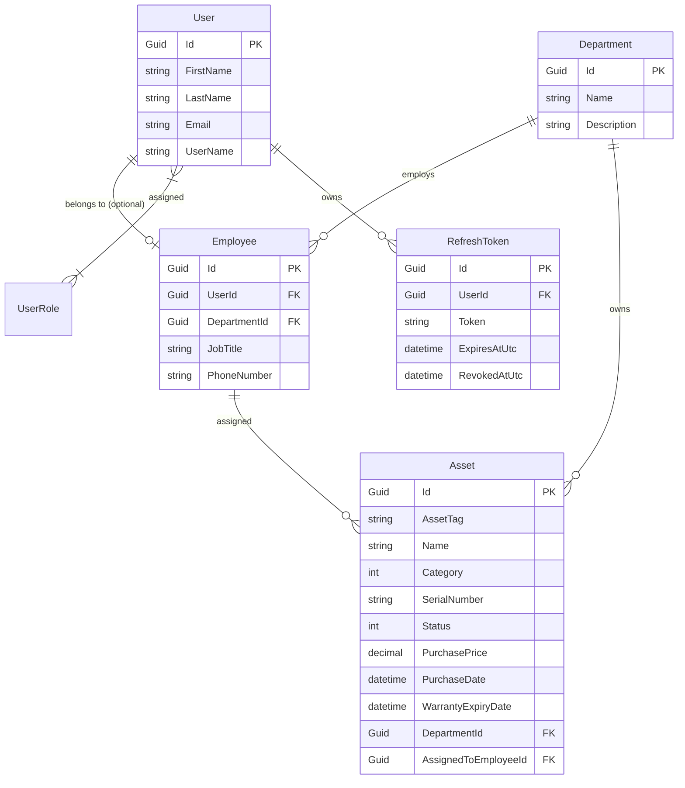

# 🏢 Asset Management System (AMS)

[](https://dotnet.microsoft.com/)
[](https://docs.microsoft.com/en-us/dotnet/csharp/)
[](https://docs.microsoft.com/ef/core/)
[](https://www.microsoft.com/sql-server)
[](https://www.hangfire.io/)
[](https://redis.io/)
[](https://groq.com/)

A modern, enterprise-grade **IT Asset Management System (AMS)** built with **.NET 10** following **Clean Architecture (Onion Architecture)** principles. Designed to manage hardware inventory, employee allocations, department assets, warranty expiration tracking, automated background jobs, and AI-assisted anomaly reporting.

---

## 📑 Table of Contents
- [Architecture Overview](#-architecture-overview)
- [Key Features](#-key-features)
- [Authorization & Scoping Model](#-authorization--scoping-model)
- [Project Structure](#-project-structure)
- [Tech Stack & Libraries](#-tech-stack--libraries)
- [Database Schema & Global Query Filters](#-database-schema--global-query-filters)
- [Background Processing (Hangfire)](#-background-processing-hangfire)
- [AI Anomaly Detection (Groq)](#-ai-anomaly-detection-groq)
- [API Endpoints Reference](#-api-endpoints-reference)
- [Getting Started & Installation](#-getting-started--installation)
- [Testing with Postman](#-testing-with-postman)

---

## 🏛 Architecture Overview

The system strictly adheres to **Clean Architecture**, enforcing separation of concerns and loose coupling via dependency inversion:

```
                      ┌─────────────────────────┐
                      │ AssetManagementSystem   │
                      │          .API           │
                      └────────────┬────────────┘
                                   │
                      ┌────────────▼────────────┐
                      │ AssetManagementSystem   │
                      │       .Application      │
                      └──────┬───────────┬──────┘
                             │           │
       ┌─────────────────────┘           └──────────────────────┐
       │                                                        │
┌──────▼──────────────────┐                       ┌─────────────▼────────────┐
│  AssetManagementSystem  │◄──────────────────────┤  AssetManagementSystem   │
│         .Domain         │                       │      .Infrastructure     │
└─────────────────────────┘                       └──────────────────────────┘
```

- **Domain Layer**: Contains enterprise entities (`Asset`, `Department`, `Employee`, `User`, `UserRole`, `RefreshToken`), enums, domain errors, auditable contracts (`IAuditable`), and repository abstractions. Has **zero** external dependencies.
- **Application Layer**: Business logic workflows, DTOs, FluentValidation rules, service implementations (`AssetService`, `AuthService`, `DashboardService`, etc.), and background job declarations.
- **Infrastructure Layer**: Concrete implementations: EF Core with SQL Server (`ApplicationDbContext`), ASP.NET Core Identity, JWT token generation, Hangfire server/storage, Redis distributed cache, EF Interceptors for audit trails, and Groq AI HTTP client.
- **API Layer**: Web API presentation layer with thin controllers, OpenAPI/Swagger UI, custom middleware (`ScopeMiddleware`, `RequestCounterMiddleware`), global exception and validation filters.

---

## ✨ Key Features

- 🔐 **Authentication & Security**:
  - ASP.NET Core Identity with custom UUID keys.
  - JWT Bearer authentication with short-lived access tokens (15m) and persistent, rotating refresh tokens (7 days).
  - Secure password hashing, email confirmation token lifecycle, and password reset flows.
- 🏢 **Multi-Role Scoped Access Control**:
  - **Admin**: Full global access across all departments, users, and assets.
  - **IT-Manager**: Scoped automatically to their assigned department via **EF Core Global Query Filters**.
  - **Employee**: Can view assets assigned directly to them.
- 💻 **Complete Asset Lifecycle**:
  - Categories: `Laptop`, `Desktop`, `Monitor`, `Phone`, `Tablet`, `Server`, `NetworkEquipment`, `Other`.
  - Statuses: `InStock`, `InUse`, `UnderMaintenance`, `Retired`, `Disposed`.
  - Serial numbers, asset tags, purchase price, purchase date, warranty expiration date.
  - Asset assignment to employees, returns/unassignments, and department transfers.
- 📊 **Executive Dashboard & Analytics**:
  - Total asset valuation and department-level distribution.
  - Asset status breakdown and category distribution.
  - Asset age distribution analysis (e.g., < 1 year, 1-2 years, 2-3 years, > 3 years).
- 🕒 **Durable Background Jobs (Hangfire)**:
  - Daily warranty expiration checker at 08:00.
  - Nightly refresh token cleaner at 03:00 to purge revoked and expired tokens.
  - Asynchronous alert dispatcher for request abuse.
  - Hangfire Dashboard mounted at `/hangfire`.
- 🤖 **AI-Augmented Abuse & Anomaly Alerts**:
  - Dynamic rate-monitoring middleware tracking requests per user.
  - Groq LLM integration generating context-aware security alerts when high request rates are detected.
- 📝 **Automatic Audit Trails**:
  - `CreatedAt`, `CreatedBy`, `UpdatedAt`, `UpdatedBy` automatically managed on `SaveChangesAsync`.
  - EF Core `AuditExecuteUpdateInterceptor` guarantees audit tracking even on bulk SQL `ExecuteUpdateAsync` operations.
- ⚡ **Hybrid Caching Layer**:
  - Distributed caching via Redis (`StackExchangeRedisCache`) with automatic graceful fallback to `DistributedMemoryCache` if Redis is offline.

---

## 💼 Business Logic 

Logjika e biznesit dhe rregullat e sistemit:


Qellimi i ketij aplikacioni eshte menaxhimi i Aseteve, Punetoreve dhe Departamenteve ne nje kompani. Logjika e biznesit qe e kom implementu ne kete aplikacion eshte kjo. 

1. Hirarkia e organizimit te aplikacionit:

                      ┌──────────────────────┐
                      │      KOMPANIA        │
                      └──────────┬───────────┘
                                 │
                   ┌─────────────┴─────────────┐
                   ▼                           ▼
         ┌──────────────────┐        ┌──────────────────┐
         │  Departamenti A  │        │  Departamenti B  │
         └─────────┬────────┘        └─────────┬────────┘
                   │                           │
          ┌────────┴────────┐         ┌────────┴────────┐
          ▼                 ▼         ▼                 ▼
    ┌───────────┐     ┌──────────┐ ┌───────────┐     ┌──────────┐
    │ Punonjësit│     │ Asetet në│ │ Punonjësit│     │ Asetet në│
    │           │     │   Stok   │ │           │     │   Stok   │
    └─────┬─────┘     └──────────┘ └─────┬─────┘     └──────────┘
          │ (Alokim)                     │ (Alokim)
          ▼                              ▼
    ┌───────────┐                  ┌───────────┐
    │ Asetet në │                  │ Asetet në │
    │ Përdorim  │                  │ Përdorim  │
    └───────────┘                  └──────────┘


2. Se pari po fillojm me asetet. Qdo Aset kur krijohet ne fillim krijohet ne nje Departament perkates, dmth nuk mundet nje Aset me u kriju pa ja caktu Departamentin. Qdo Aset domosdoshmerisht ka Departament. Nje aset mund ti vendoset nje punetori apo te jete pa punetor. IT-Menageri qe eshte ne departament te njejte me asetin ka te drejte mbi asetet e ati departamenti te bej ndryshime por jo te ja nderroj departmanetin ati aseti. Admini ka te drejte te plote mbi asetet qe te ndryshoj edhe departamentin ama vetem nese ska punetor ne pronesi te ati departamenti sepse edhe punetoret ne pronesi te atij aseti duhet me qene vetem ne ate departament.Ja nje pershkrim i nje aseti i cili ka 4 gjendje: In Stock, In Repair, Assigned , Retired:

                   
                    ┌──────────────┐
                    │   IN STOCK   │◄────────────────┐
                    └──────┬───────┘                 │
                           │                         │
                        Assign                     Fixed
                           │                         │
                           ▼                         │
                    ┌──────────────┐          ┌──────┴─────┐
                    │   ASSIGNED   │──Repair─►│ IN REPAIR  │
                    └──────┬───────┘          └──────┬─────┘
                           │                         │
                 ┌─────────┴─────────┐               │
                 │                   │               │
              Return             Decommission    Decommission
                 │                   │               │
                 ▼                   ▼               ▼
           ┌──────────┐        ┌─────────────────────────┐
           │ IN STOCK │        │        RETIRED          │
           └──────────┘        └─────────────────────────┘


3. Nje punetor kur krijohet duhet te jete domosdoshmerisht te percaktuar ne nje departament. Nuk mund te ekzistoj punetor pa departament. Nje punetor mund te jete me rol punetor i thjeshte dhe mund te jete IT-Menager. Krijimi i nje punetori behet me create user dhe nese ja jep rolin employee ose IT-Menager duhet patjeter te perfshij pastaj edhe departmentId qe i perket edhe employeeCode. Rolin client e ko bo vetem per regjistrim sa per me pas si opsion sepse ai ska te drejt asgje, vetem per ta demonstruar regjistrimin sepse asnje punetor nuk guxon me bo regjistrim ata krijohen vetem nga Admini. Admini ka te drejte ta fshij ose ta ndryshoj nje punetor vetem nese ai punetor nuk ka asete ne pronesi sepse ato asete njeher duhet te barten ne departmantin tjeter qe pastaj te lejohet te i nderrohet asetit departamenti e pastaj te u behen assigned ato asete ati punetori.

4. Nje Departament ka asete dhe punetor. Asetet mund te perkasin vetem departamentit por mund ti perkasin edhe nje punetori.   Ja nje pershkrim vizual i nje departamenti:

Department                                                  
   │
   ├── Employees
   │      │
   │      └── Assigned Assets
   │
   └── Department-owned / available Assets                 


                ┌─────────────┐
                │  DEPARTMENT │
                └──────┬──────┘
                       │
             ┌─────────┴─────────┐
             │                   │
        Employees             Assets
             │                   │
             │                   │
             └───────┬───────────┘
                     │
               Assignment
                     │
                     ▼
                  Employee


5. Modeli i Autorizimit dhe Scope:


                       AUTHORIZATION
                         │
          ┌──────────────┼──────────────┐
          ▼              ▼              ▼
        ADMIN       IT MANAGER       EMPLOYEE
          │              │              │
        ALL          DEPARTMENT       OWN ASSETS


                       Authorization
                         │
              ┌──────────┴──────────┐
              │                     │
            Admin               IT Manager
              │                     │
          Global Scope         Department Scope
              │                     │
              ▼                     ▼
        All Departments        Own Department
                                    │
                                    ▼
                                 Assets
                                    │
                                    ▼
                                Employees


EF Core Global Query Filter: Për rolin `IT-Manager`, aplikacioni filtron automatikisht çdo query në bazën e të dhënave (`asset.DepartmentId == currentScope.DepartmentId`), duke garantuar izolim të plotë të të dhënave në nivel të dhënash pa rrezik gabimi nga programuesi.    

Nivelet e Scope:

   Niveli Global (Admin):

Nuk ka asnjë kufizim departamenti.
I vetmi rol që mund të krijojë/fshijë Departamente, të transferojë asete/punonjës mes departamenteve dhe të menaxhojë rolet.

   Niveli i Departamentit (IT-Manager):

Çdo query dhe veprim i kufizohet automatikisht në departamentin ku bën pjesë.
Ka rol operativ: menaxhon pajisjet, i dërgon për riparim, ia cakton punonjësve të departamentit të vet, dhe sheh statistikat e departamentit të vet.
Nuk mund të prekë asetet, stafin apo statistikat e departamenteve të tjera.

   Niveli Vetjak (Employee / Client):

Nuk ka qasje në panelin administrativ të aseteve apo departamenteve.
Qasja e tyre kufizohet te llogaria e tyre personale (/api/account/me), ndryshimi i fjalëkalimit dhe pajisjet që u janë caktuar personalisht


```

### Automatic Scope Filter in EF Core
Rather than manually appending `.Where(a => a.DepartmentId == currentDeptId)` in every query, `ApplicationDbContext` enforces a **Global Query Filter**:

```csharp
builder.Entity<Asset>().HasQueryFilter(
    asset => _scope.IsGlobal || asset.DepartmentId == _scope.DepartmentId);
```
`ScopeMiddleware` inspects the authenticated user's role and employee record on each HTTP request, populating `IScopeContext`.

---

## 📁 Project Structure

```bash
Asset-Management-App/
│
├── Asset-Management-System.slnx        # Solution file (.NET 10)
│
├── AssetManagementSystem.API/           # Presentation Layer
│   ├── Controllers/                     # API Endpoints (Auth, Assets, Users, etc.)
│   ├── Filters/                         # ValidationFilter, ExceptionFilter
│   ├── Middleware/                      # ScopeMiddleware, RequestCounterMiddleware
│   ├── OpenApi/                         # Swagger Bearer Transformer
│   ├── Program.cs                       # Application entrypoint & pipeline
│   └── appsettings.json                 # Connection strings & config
│
├── AssetManagementSystem.Application/   # Application Core (Use Cases)
│   ├── Common/                          # Shared models, Scope resolver
│   ├── DTOs/                            # Request & Response Contracts
│   ├── DependencyInjection/             # Service registrations
│   ├── Interfaces/                      # Application service interfaces
│   ├── Services/                        # Business logic implementations
│   └── Validators/                      # FluentValidation rules
│
├── AssetManagementSystem.Domain/        # Enterprise Core (Entities & Rules)
│   ├── Common/                          # BaseEntity, IAuditable, AppRoles
│   ├── Entities/                        # Asset, Department, Employee, User
│   ├── Enums/                           # AssetCategory, AssetStatus
│   ├── Errors/                          # Domain error definitions
│   ├── Interfaces/                      # Repository and contract interfaces
│   └── ReadModels/                      # Lightweight projection models
│
├── AssetManagementSystem.Infrastructure/# External Concerns & Data Access
│   ├── Ai/                              # Groq LLM client (GroqFeedbackGenerator)
│   ├── ApplicationDbContext.cs          # EF Core DbContext with Global Filters
│   ├── Authorization/                   # ScopeContext implementation
│   ├── Configurations/                  # EF Core EntityTypeConfigurations
│   ├── DatabaseSeeder.cs                # Automatic roles & superadmin seeding
│   ├── Identity/                        # JWT generator, UserAccessor
│   ├── Interceptors/                    # AuditExecuteUpdateInterceptor
│   ├── Migrations/                      # EF Core migration history
│   └── Repositories/                    # Concrete repository implementations
│
└── postman/                             # Postman Collection for automated testing
    └── AssetManagementSystem.postman_collection.json
```

---

## 🧰 Tech Stack & Libraries

| Technology | Purpose |
|---|---|
| **.NET 10 / C# 13** | Core runtime and modern language features |
| **ASP.NET Core Web API** | REST API framework |
| **Entity Framework Core 10** | ORM for SQL Server |
| **SQL Server** | Primary relational database |
| **ASP.NET Core Identity** | User authentication, password hashing, and role management |
| **System.IdentityModel.Tokens.Jwt** | JWT authentication & token validation |
| **Hangfire 1.8.25** | Persistent background job processing with SQL Server storage |
| **StackExchange.Redis** | Distributed caching provider |
| **FluentValidation** | Declarative input validation rules |
| **Groq API** | High-speed LLM inference for security analytics |
| **Swashbuckle / OpenAPI** | Interactive API documentation and testing |

---

## 🗄 Database Schema & Key Entities



---

## ⚙ Background Processing (Hangfire)

Hangfire is configured with durable SQL Server storage. Jobs survive server restarts and scale across multiple nodes.

| Job Name | Schedule | Method | Purpose |
|---|---|---|---|
| `warranty-expiry-check` | Daily at 08:00 | `IWarrantyExpireJob.ExecuteAsync` | Scans for assets whose warranty expires within 30 days and sends alerts |
| `refresh-token-cleanup` | Daily at 03:00 | `IRefreshTokenCleanupJob.ExecuteAsync` | Purges expired and revoked refresh tokens from database |
| `abuse-alert-job` | On-demand (triggered) | `IAbuseAlertJob.ExecuteAsync` | Sends email alerts with AI-generated summaries on rapid GET traffic |

Hangfire Dashboard is accessible at:
```
http://localhost:<port>/hangfire
```

---

## 🤖 AI Anomaly Detection (Groq)

When high request bursts are detected by `RequestCounterMiddleware`:
1. The request counter increments per user/endpoint bucket.
2. If traffic exceeds thresholds, `AbuseAlertJob` is scheduled in Hangfire.
3. `GroqFeedbackGenerator` connects to the **Groq API** via `HttpClient` using the configured model (`openai/gpt-oss-20b` or Llama 3) to evaluate endpoint sensitivity and generate a natural-language report for administrators.
4. Fallback logic ensures that even if the AI service or network is unavailable, notification emails are delivered without interruption.

---

## 📡 API Endpoints Reference

### 🔑 Authentication (`/api/auth`)
| Method | Endpoint | Access | Description |
|---|---|---|---|
| `POST` | `/api/auth/register` | Anonymous | Register a new client account |
| `POST` | `/api/auth/login` | Anonymous | Authenticate and obtain JWT + Refresh Token |
| `POST` | `/api/auth/confirm-email` | Anonymous | Confirm email address |
| `POST` | `/api/auth/resend-confirmation` | Anonymous | Resend confirmation email |
| `POST` | `/api/auth/forgot-password` | Anonymous | Request password reset token |
| `POST` | `/api/auth/reset-password` | Anonymous | Reset password with token |
| `POST` | `/api/auth/refresh` | Anonymous | Exchange refresh token for new access token |
| `POST` | `/api/auth/logout` | Authenticated | Revoke refresh token and end session |

### 👤 Current Account (`/api/account`)
| Method | Endpoint | Access | Description |
|---|---|---|---|
| `GET` | `/api/account/me` | Authenticated | Get current user profile and roles |
| `POST` | `/api/account/change-password` | Authenticated | Change current user password |

### 💻 Assets (`/api/assets`)
| Method | Endpoint | Access | Description |
|---|---|---|---|
| `GET` | `/api/assets` | Admin, IT-Manager | Get paginated list of assets (scoped) |
| `GET` | `/api/assets/{id}` | Admin, IT-Manager | Get asset details by ID |
| `POST` | `/api/assets` | Admin, IT-Manager | Create a new asset |
| `PUT` | `/api/assets/{id}` | Admin, IT-Manager | Update existing asset |
| `DELETE` | `/api/assets/{id}` | Admin | Delete an asset |
| `GET` | `/api/assets/categories` | Admin, IT-Manager | List all asset categories |
| `GET` | `/api/assets/statuses` | Admin, IT-Manager | List all asset statuses |
| `POST` | `/api/assets/{id}/assign` | Admin, IT-Manager | Assign asset to an employee |
| `POST` | `/api/assets/{id}/unassign` | Admin, IT-Manager | Unassign asset back to stock |
| `POST` | `/api/assets/{id}/transfer-department` | Admin | Transfer asset to another department |
| `POST` | `/api/assets/departments/{deptId}/release-from-employees` | Admin, IT-Manager | Release all department assets from employees |

### 🏢 Departments (`/api/departments`)
| Method | Endpoint | Access | Description |
|---|---|---|---|
| `GET` | `/api/departments` | Admin, IT-Manager | List departments (paginated) |
| `GET` | `/api/departments/{id}` | Admin, IT-Manager | Get department by ID |
| `POST` | `/api/departments` | Admin | Create new department |
| `PUT` | `/api/departments/{id}` | Admin | Update department |
| `DELETE` | `/api/departments/{id}` | Admin | Delete department |

### 👥 Employees (`/api/employees`)
| Method | Endpoint | Access | Description |
|---|---|---|---|
| `GET` | `/api/employees` | Admin, IT-Manager | List employees (paginated, scoped) |
| `GET` | `/api/employees/{id}` | Admin, IT-Manager | Get employee by ID |
| `PUT` | `/api/employees/{id}` | Admin, IT-Manager | Update employee info |
| `POST` | `/api/employees/{id}/transfer-department` | Admin | Transfer employee to new department |

### 🛡 User Administration (`/api/users`)
| Method | Endpoint | Access | Description |
|---|---|---|---|
| `GET` | `/api/users` | Admin | List all registered users |
| `POST` | `/api/users` | Admin | Create user with optional role/employee profile |
| `PUT` | `/api/users/{id}` | Admin, IT-Manager | Update user details (scoped) |
| `DELETE` | `/api/users/{id}` | Admin | Delete user and associated employee profile |
| `POST` | `/api/users/{id}/roles` | Admin | Assign role to user |
| `DELETE` | `/api/users/{id}/roles/{roleName}` | Admin | Remove role from user |

### 📈 Analytics Dashboard (`/api/dashboard`)
| Method | Endpoint | Access | Description |
|---|---|---|---|
| `GET` | `/api/dashboard/total-value` | Admin, IT-Manager | Total valuation summary of assets |
| `GET` | `/api/dashboard/value-by-department` | Admin, IT-Manager | Valuation grouped by department |
| `GET` | `/api/dashboard/assets-by-status` | Admin, IT-Manager | Asset count and value by status |
| `GET` | `/api/dashboard/assets-by-category` | Admin, IT-Manager | Asset count and value by category |
| `GET` | `/api/dashboard/asset-age` | Admin, IT-Manager | Asset age bracket distribution |

---

## 🚀 Getting Started & Installation

### Prerequisites
- [.NET 10 SDK](https://dotnet.microsoft.com/download)
- [SQL Server](https://www.microsoft.com/sql-server) or SQL Server LocalDB
- [Redis](https://redis.io/) *(Optional; in-memory cache is used as fallback)*
- [Groq API Key](https://console.groq.com/) *(Optional; required for AI-generated abuse reports)*

### 1. Clone the repository
```bash
git clone https://github.com/GentiR-ui/Asset-Management-App.git
cd Asset-Management-App
```

### 2. Configure Settings & Secrets
Update `AssetManagementSystem.API/appsettings.json` or configure secrets:

```bash
cd AssetManagementSystem.API

# Configure JWT Secret Key (required)
dotnet user-secrets set "JwtSettings:Key" "A-Very-Long-And-Secure-Secret-Key-Must-Be-At-Least-256-Bits!"

# Configure Initial Admin User for auto-seeding
dotnet user-secrets set "SeedAdmin:Email" "admin@company.com"
dotnet user-secrets set "SeedAdmin:Password" "Admin@123456"

# Configure Groq API Key (Optional)
dotnet user-secrets set "Groq:ApiKey" "gsk_your_groq_api_key_here"
```

### 3. Apply Database Migrations
```bash
dotnet ef database update --project ../AssetManagementSystem.Infrastructure --startup-project .
```

### 4. Run the API
```bash
dotnet run
```
Once launched:
- **Swagger UI**: `http://localhost:<port>/swagger`
- **Hangfire Dashboard**: `http://localhost:<port>/hangfire`

---

## 📮 Testing with Postman

A comprehensive Postman test suite is pre-configured and included in the repository:
```
postman/AssetManagementSystem.postman_collection.json
```

### How to use:
1. Open **Postman** and click **Import**.
2. Select `postman/AssetManagementSystem.postman_collection.json`.
3. Set your environment variable:
   - `baseUrl` -> `http://localhost:<port>`
4. Run requests in sequence:
   - **Auth -> Login** (JWT token will be saved automatically to collection variables).
   - Test **Assets**, **Departments**, **Employees**, and **Dashboard** endpoints.

---

## 📄 License
This project is developed as part of an engineering internship. All rights reserved.
